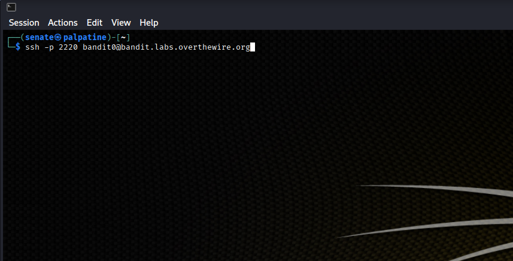

# Bandit Level 0 – SSH Connection

## Overview

This was the starting point of the OverTheWire Bandit wargame. The objective was to connect to the Bandit server using SSH.

I used Kali Linux and its terminal to establish a connection to the remote server.

## Step 1 – Open the terminal

I started by opening the terminal in Kali Linux. From there, I was able to enter the SSH command needed to connect to the Bandit server.

## Step 2 – Connect using SSH

I entered the following command:

```bash
ssh -p 2220 bandit0@bandit.labs.overthewire.org
```

This started an SSH connection to the OverTheWire server.

**Command breakdown:**

- `ssh` – Starts a Secure Shell connection.
- `bandit0` – The username used to log in.
- `bandit.labs.overthewire.org` – The remote server hostname.
- `-p 2220` – Specifies the port used for the connection.

### Screenshot – SSH command



## Step 3 – Authenticate

After running the command, I was prompted to enter a password.

I entered the initial password provided in the Bandit instructions. Once authenticated, I was successfully connected to the remote server as `bandit0`.

### Screenshot – Successful connection

<!-- Insert terminal screenshot here -->

## What I Learned

This was a straightforward introduction to SSH, but it was useful to get back into using the Linux terminal.

I learned how to connect to a remote Linux machine, specify a custom SSH port, and authenticate using a username and password.

SSH is commonly used to remotely access and manage Linux servers, so understanding the basics is useful going forward.

## Notes

This level was mainly about getting connected to the Bandit environment. The actual challenges involving Linux commands and finding passwords begin in the following level.
